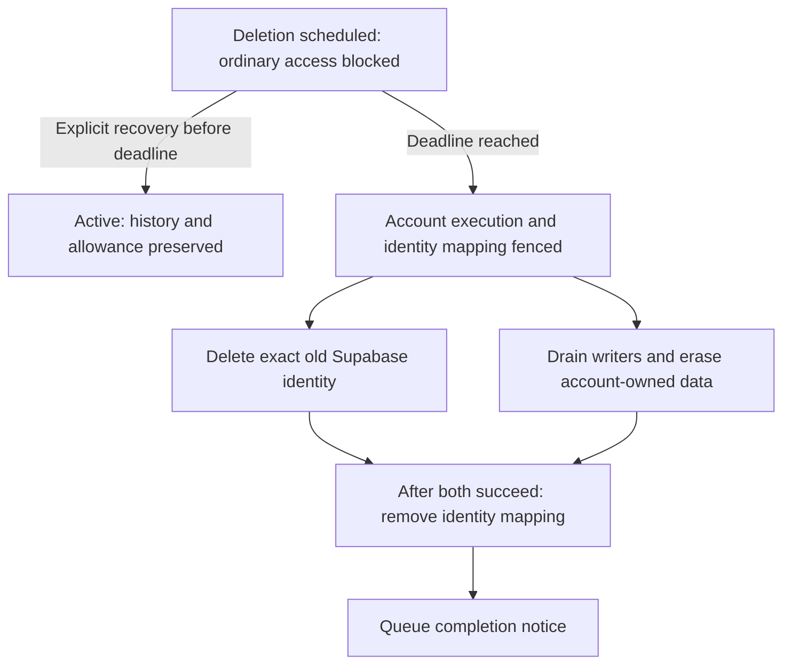

# Account deletion and recovery

[Account deletion](../GLOSSARY.md#account-deletion) is the full lifecycle spanning account state, conversion execution, object storage, Supabase identity, and notifications. [Account erasure](../GLOSSARY.md#account-erasure) is its internal step for removing Cup-owned content and records. User-facing copy uses account deletion. Scheduling blocks ordinary access immediately and allows explicitly confirmed recovery for seven days. The registry coordinates durable cleanup independently of the account being erased.

[Open this diagram in Mermaid Live](https://mermaid.live/view#pako:eJx1kcuO2zAMRX-F0Dr5AS8KBHULdFOgSFe1Z8FQ17ZQWTRoKQ9M5t8L28kA7aArSby8hw-9OlEPV7ku6kUGtkw_6zYRER1lgC8RvqkRkYMmmp-hitR8SGw3YhHMM52iym_4l3-8tN9_un-5TjFIyGQQPcNudEKnBvJgH0PC_SA5nNFsR0VDmLMu7OSJY9QLJwFNhhl2_k-R-sEiAy_C_SuSwDcHES0pE66Qsk6xUINHyiHfaORpCqmnbs1-kDfrgqVvj8RtCSBcWTJp9HQsE594xjvro_mY1bhHUxuHRBcLGTav9WGLk7fe9npJ8OQ584PxrLpSPus4LbWbQ5dhdNI80FxEsPyDYdQzPszzXNHWwF-YTXm-Vum75iBofhQUkGzKsqm0xl_czo2wkYN3lXtd_K3LA0a0rqLWGXy57kWjWuva9OZ2rkyeM-rAvfHoqmwFO9fbAtjuE6dfqu-SaekHV3UcZ7z9AYHi6Qc)

Identity deletion and Cup storage cleanup retry independently; an identity-provider outage does not prevent Cup cleanup. The diagram shows dependencies, not a distributed transaction.

## Confirmation and recovery

Deletion and recovery require a one-use challenge and fresh authentication for the same identity, with a method from the challenge's `acceptedMethods`, as described in [authentication](authentication.md#operator-access-and-lifecycle-confirmation). Signing in alone does not restore access.

Lifecycle endpoints belong to the [listener API](README.md#api-definitions). A refused confirmation is an explicit conflict, while unexpected storage or registry failures remain operational errors. The confirmation request may carry a `providerCredential` discriminated by provider: Google's access token, the refresh token Apple issued for a web Apple sign-in (Supabase's `provider_refresh_token`), or the authorization code Apple's native sheet returned on iOS. A restore request carries no Apple credential.

### Apple revocation before scheduling

Apple requires that deleting an account created with Sign in with Apple revokes Cup's Apple authorization, and Cup stores no Apple token ([ADR 0119](../adr/0119-confirm-apple-linked-deletion-with-a-fresh-apple-sign-in-and-revoke-its-credential.md)). Deleting an account whose identity has Apple among its linked providers is therefore confirmed only with a fresh Apple sign-in: its challenge accepts Apple alone, also when Google is linked too. The confirmation shows one "Continue with Apple" button and the line "Can't sign in with Apple? Email support\@cup.audio." The Worker then works in this order, and schedules nothing when a step fails:

1. It refuses the request without an Apple credential (`fresh-auth-required`).
2. It reads the account's Apple subject from the Supabase identity and learns the credential's Apple subject from an ID token Apple returns. It validates a web refresh token with a `refresh_token` grant as the Services ID `audio.cup.app.web`. It exchanges a native authorization code with an `authorization_code` grant as the App ID `audio.cup.app`, the client the sheet issued it to; Apple accepts a code once and for five minutes, and the exchange returns the refresh token the Worker revokes.
3. It refuses a subject other than the account's Apple identity (`apple-account-mismatch`), and the client asks to use the Apple Account linked to this Cup account.
4. It revokes the refresh token at Apple.
5. It schedules the deletion with `appleRevocation: revoked`.

A failed exchange, validation or revocation, including a native code that expired or was used before, answers the retryable `apple-confirmation-failed`, and the client says that Apple couldn't confirm the deletion, that the account is still active and nothing will be deleted. Either refusal drops the challenge, so a retry starts with a new challenge and a new sign-in. A revocation followed by a failed scheduling is harmless: revocation is idempotent, and the listener signs in with Apple again. Failures are captured as operational errors without the token, the code or Apple's response body, with no Sentry warning type of their own. The [Apple client](../../libs/api-server/src/adapters/apple-sign-in-revocation.ts) signs a five-minute ES256 client secret with the Worker secret `APPLE_SIGN_IN_KEY` for each request and talks to `APPLE_ORIGIN` ([production configuration](../production-configuration.md#worker-configuration)); [`apple-deletion-confirmation.test.ts`](../../libs/api-server/test/apple-deletion-confirmation.test.ts) covers the order, the refusals and the client secret for both credentials, the [accounts E2E suite](../../qa/e2e/test-e2e/accounts.test.ts) the web flow against the test Worker's fake Apple, the [Android Apple sign-in spec](../../qa/mobile-e2e/test/android/apple-sign-in.test.ts) a confirmation with the refresh token of a fresh sign-in in a browser tab, and the [iOS Apple sign-in spec](../../qa/mobile-e2e/test/ios/apple-sign-in.test.ts) a native confirmation, first with an expired code and then with a fresh one.

For a Google-only account, nothing changes: after scheduling, the API attempts Google token revocation when the client supplies a Google credential for an identity linked to Google, verifies that the token belongs to the same identity, and records the outcome. Revocation failure does not undo scheduling; a failure to record the outcome is reported as an operational error, not a rejected confirmation.

The deletion job and its receipt record `appleRevocation`, set at scheduling: `unavailable` without an Apple identity, `revoked` after the self-service path above, and `not-revoked` for a deletion the operator schedules for a [lost Apple Account](#lost-apple-account). The [operator listing](../../apps/operator/README.md#list-account-deletions) shows it next to `googleRevocation` for each unfinished attempt. The registry's [`deletion-coordinator.test.ts`](../../libs/registry/test/deletion-coordinator.test.ts) covers both records.

### Lost Apple Account

A listener who can no longer sign in with Apple can't confirm deletion and asks `support@cup.audio`. Support asks them to write from, or reply to support at, the email address the account holds, and the operator schedules the deletion only for a matching address; if a Hide My Email relay address no longer forwards, ownership can't be proven and the account stays. The [operator runbook](../../apps/operator/README.md#delete-the-account-of-a-listener-who-lost-their-apple-account) records the steps.

The operator route goes through Cloudflare Access like every operator route. The Worker refuses an unknown account, an account whose Supabase identity has no Apple identity, an address other than the identity's own, and an account that is not active. Otherwise the account schedules the deletion without a challenge, with the same recovery period and scheduled-deletion notice as self-service, revokes nothing at Apple, and records `appleRevocation: not-revoked`. [`lost-apple-account-deletion.test.ts`](../../libs/api-server/test/lost-apple-account-deletion.test.ts) covers the refusals and that Apple is never called, and the registry's `deletion-coordinator.test.ts` the record, the listing and the notice.

### Apple sign-ins during the seven days

Every Apple sign-in into an account scheduled for deletion is revoked too, so that no Apple authorization outlives the erasure. After an Apple sign-in, once the account snapshot shows `deletion_scheduled` or `deleting`, the client posts the sign-in's Apple credential, the refresh token on the web or the authorization code on iOS, to `POST /api/account/apple-sign-in-revocation`, which carries the bearer token and passes the same origin and content-type checks as the lifecycle routes. The listener sees nothing. The Worker validates or exchanges the credential and revokes as in the steps above only when the account is `deletion_scheduled` or `deleting`, has an Apple identity, and Apple names that identity's subject; otherwise it does nothing. It answers `204` in every case, so the answer reveals nothing, and captures a failed exchange, validation or revocation as an operational error without the credential. The sign-in that confirms recovery is revoked the same way: the client posts its credential, and waits for that, before it sends the restore request, which itself carries no Apple credential. The credential of the sign-in that confirms a deletion is revoked by the deletion itself, so the client never posts it again. These revocations are not recorded per sign-in. The web adapter tells the client that a page load returned from Apple's flow with a code ([`account-auth.web.test.ts`](../../apps/web-app/src/platform/account-auth.web.test.ts)), and the iOS adapter that the native sheet's sign-in completed, holding its code in memory ([`account-auth.ios.test.ts`](../../apps/web-app/src/platform/account-auth.ios.test.ts)); [`apple-sign-in-revocation.test.ts`](../../libs/api-server/test/apple-sign-in-revocation.test.ts) covers the route, and the [accounts E2E suite](../../qa/e2e/test-e2e/accounts.test.ts) a sign-in during the seven days and the recovery sign-in against the fake Apple.

### Recovery

Recovery accepts every linked provider, and the confirmation shows one button per accepted method, Apple first. A Google-only account's deletion or recovery signs in again with Google at once, as before.

Scheduling signs the requesting client out, which stops playback, and blocks subsequent private access checks. Lifecycle inspection and explicit recovery, after signing in again, remain available until the deadline; the scheduled-deletion notice links the web app's [account recovery page](web-app.md#routes-and-navigation), which signs the listener in for that. Recovery preserves history and allowance; once the deadline is reached, recovery is refused. The registry's [`accounts.test.ts`](../../libs/registry/test/accounts.test.ts) covers fresh authentication and recovery, and [`account-lifecycle-api.test.ts`](../../libs/api-server/test/account-lifecycle-api.test.ts) the API's origin checks and revocation outcomes.

Sources: [client confirmation](../../apps/web-app/src/data-fetching/account-confirmation.ts), [client revocation of Apple sign-ins](../../apps/web-app/src/data-fetching/apple-sign-in-revocation.ts), [lifecycle API](../../libs/api-server/src/api-server.ts), and [atomic account transitions](../../libs/accounts/src/storage/account-lifecycle.ts).

## Fencing and cleanup

The account persists lifecycle changes and delivery intent together, then delivers that intent to the registry through a replayable outbox. At cleanup, changing the execution epoch prevents old workflow activity from writing. Registered artifact writers must drain and uncertain storage effects must be reconciled before erasure; a lost acknowledgement does not prove a writer stopped.

Account erasure removes the account's R2 prefix, conversion-owner routes, and account records, retaining a constant erasure marker to reject late execution. The registry deletes the exact old Supabase identity and removes its mapping only after both identity and account cleanup succeed. Original trial conversions and other accounts remain separate; the registry's `accounts.test.ts` checks that erasure waits for an in-flight upload and preserves both. Erasure subsumes any [conversion deletion](conversion-deletion.md) whose cleanup is still in progress, which needs no handoff.

The coordinator awaits account and provider calls with its Durable Object input gate open, so a restore delivery or a Google revocation outcome can be accepted while it waits. It continues from the stored job after an awaited fence, and a failed attempt does not overwrite a restore accepted meanwhile ([`deletion-coordinator.test.ts`](../../libs/registry/test/deletion-coordinator.test.ts)).

Failures retain durable progress and retry with backoff. Each pass whose identity deletion or account erasure fails sends an `account-deletion-identity-failed` or `account-deletion-erasure-failed` warning to Sentry with the account ID, the attempt ID and the failure's root cause ([log records](observability-operations.md#log-records)). An attempt still neither erased nor restored well after its recovery deadline is a [stuck account deletion](../GLOSSARY.md#stuck-account-deletion); the [deletion coordinator](../../libs/registry/src/account-deletion/deletion-coordinator.ts) holds the threshold. Its alarm pass then reports the attempt to Sentry once, tagged with what is pending: the identity, the account (its fence or erasure), or both ([stuck checks](observability-operations.md#stuck-checks)). Operators can inspect stuck cleanup, which the listing marks `overdue`, with the [operator CLI](../../apps/operator/README.md#list-account-deletions); there is no force-complete action that discards uncertain writers.

Sources: [account cleanup](../../libs/accounts/src/durable-object/account-durable-object.ts), [writer reconciliation](../../libs/accounts/src/storage/account-artifact-writers.ts), [registry alarms](../../libs/registry/src/durable-object/registry-durable-object.ts), [coordinator](../../libs/registry/src/account-deletion/deletion-coordinator.ts), and [Supabase identity deletion](../../libs/registry/src/providers/supabase-identity.ts).

## Notifications and retained evidence

Scheduled and completed notices have durable intent and distinct immutable idempotency keys. Retries stop before the provider deduplication window expires to avoid duplicate sends after ambiguous outcomes. Provider acceptance does not establish inbox delivery.

Terminal notification payloads are redacted. After cleanup and notification processing finish, receipts retain identifiers, timestamps, and outcomes for 90 days, excluding email, tokens, and provider response bodies. The account's erasure marker carries no deletion-attempt identifier. These application rules do not establish retention in external provider logs or backups.

Notices go to Resend. A permanent rejection is final; other failures, timeouts, and lost responses retry with backoff, no earlier than the provider asks. A notice that ends `failed` or `expired` sends an `account-deletion-notice-undelivered` warning with its type (`scheduled` or `completed`), its end state and the attempt ID, never the email address. The [coordinator tests](../../libs/registry/test/deletion-coordinator.test.ts) assert exactly one email per notification key against the [Resend stub](../../qa/resend-stub/src/resend-stub.ts), including after ambiguous outcomes; the [stub's guide](../../qa/resend-stub/README.md) describes it and its opt-in live contract test.

Sources: [notification and receipt implementation](../../libs/registry/src/account-deletion/deletion-coordinator.ts) and the [Resend call](../../libs/registry/src/providers/resend-email.ts). See [production configuration](../production-configuration.md#email) for configuration and the [operator CLI](../../apps/operator/README.md#list-account-deletions) for inspection.

Related research: [provider deletion](../research/social-signup/account-deletion-research.md), [transactional email](../research/social-signup/transactional-email-research.md), and [telemetry retention](../research/social-signup/telemetry-retention-research.md).
