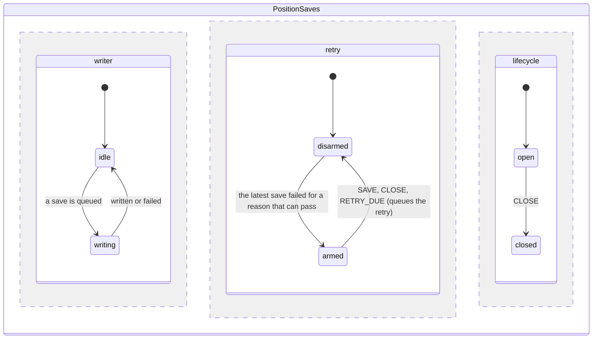

# Playback

The web player plays an audiobook's [narration track](../GLOSSARY.md#narration-track), restores and saves the listener's listening position, and drives the system's media controls. In the Android app a native ExoPlayer plays the track instead, driven by the same player host. The [conversion](conversion.md#delivery-and-lifecycle) page describes how the track is joined from segments and served, and [authentication](authentication.md#signed-media-url) how its signed URL authorizes and renews.

## The web player

The web player plays the narration track with one `<audio>` element in browsers and the iOS app ([ADR 0011](../adr/0011-serve-one-narration-track-and-play-it-with-one-audio-element.md)). The [player host](../../apps/web-app/src/app/player/player-host.ts) reaches it only through the `Player` port, whose implementation [`createPlatformPlayers`](../../apps/web-app/src/app/player/create-playback.ts) chooses once per platform. In browsers and iOS, every player plays on the same element, created once for the app shell's lifetime, with the loaded audiobook's track URL as its `src`; the signed URL carries the authorization, and the content security policy allows media only from the API origin's `/api/files/`.

- **State:** the element and its events are the playback state; the player keeps no state machine. The [player host](#the-player-host) and [position saves](#listening-positions) above it are machines ([ADR 0034](../adr/0034-model-the-player-host-and-position-saves-as-xstate-machines.md)).
- **Timeline:** the response's start offsets map `currentTime` to the current unit, which drives the reader's highlight; seeking sets `currentTime`. The reader finds a segment only through its `[data-synchronization-unit]` elements, and highlights, marks as failed and plays it across all of them, such as a heading and the first item of the list it introduces ([rendering](conversion.md#rendering-the-narration-document)). A seek waits until the element reports a duration above 0, because WebKit's GStreamer media backend on Linux first reports 0, and a seek then can end playback at once; the next media event that finds the duration known applies it.
- **Play:** `play()` is called synchronously within the user gesture, because Mobile Safari refuses audio started after an await. A stale or failed track URL is [renewed](authentication.md#signed-media-url) first.

The [app E2E suite](../../qa/e2e/test-e2e/conversion.test.ts) plays a served track in Chromium and WebKit.

## The player host

The web application holds one player for every page inside its [app shell](../../apps/web-app/src/routes/_shell.tsx), so playback continues while the listener moves between pages. Recents controls the loaded audiobook through the [mini player](../../apps/web-app/src/app/components/mini-player.tsx) above its [tab bar](../../apps/web-app/src/app/components/account-tab-bar.tsx), and every detail view controls the audiobook it shows through the [player sheet](../../apps/web-app/src/app/components/player-sheet.tsx), which is disabled until that audiobook has a narration track. The player host holds at most one loaded audiobook; [`player-host.test.ts`](../../apps/web-app/src/app/player/player-host.test.ts) holds these rules:

- **Loading:** an audiobook loads only when the listener plays it, taps a segment, or seeks or skips in the sheet, not when its detail view opens. Loading replaces another loaded audiobook and saves that one's position.
- **Before loading:** a detail view shows the listener's listening position in the sheet and highlights its segment, without creating a player; while the account is being restored it shows the start.
- **Unloading:** the loaded audiobook is unloaded on leaving the shell, a change of the signed-in user, the track's deletion, or when renewing its URL finds the track gone. A reload restores it only from Android's native session ([adoption](#androids-native-engine)).
- **Track:** a loaded narration track never changes, because it exists only once every segment has audio; only its signed URL is [renewed](authentication.md#signed-media-url).

The host's lifecycle is the XState machine in [`player-host-machine.ts`](../../apps/web-app/src/app/player/player-host-machine.ts), which `PlayerHost` fronts. Two regions run side by side; the diagram shows states and events, not every guard:

```mermaid
stateDiagram-v2
  state PlayerHost {
    state playback {
      [*] --> empty
      empty --> loading: LOAD_SHOWN / takeover
      loaded --> loading: LOAD_SHOWN
      loading --> loaded: player built
      loading --> empty: build failed
      loaded --> empty: UNLOAD, RELEASE, another account, track gone
      state loaded {
        [*] --> ready
        ready --> renewingTrackUrl: PLAY with a stale or failed URL
        renewingTrackUrl --> ready: renewed (plays), failed, PAUSE
      }
    }
    --
    state adoption {
      [*] --> notStarted
      notStarted --> findingRunningPlayer: ADOPT
      findingRunningPlayer --> awaitingAccount: found
      awaitingAccount --> fetchingAudiobook: account known, the listener's
      fetchingAudiobook --> handingOver: handed to playback
      handingOver --> done: built, or failed
      fetchingAudiobook --> done: discarded
      findingRunningPlayer --> done: none
      awaitingAccount --> done: loaded already, another account's, or a load
      fetchingAudiobook --> done: a load
    }
  }
```

Leaving `renewingTrackUrl` cancels a renewal, so one that arrives after Pause, an unload or another load plays nothing. An audiobook whose listening session would be refused fails the tap without leaving `loaded`. The machine's comments and [ADR 0034](../adr/0034-model-the-player-host-and-position-saves-as-xstate-machines.md) hold the rest: how `loading` keeps Play within the tap's gesture, and why a failing port is reported instead of stopping the host.

## Listening positions

Each signed-in listener has one saved position per conversion, a synchronization unit and an offset within its audio, which the server replaces on every save; anonymous positions stay on the device. Loading restores it; a loaded player is never moved by query refreshes or other devices' saves, so device switches resume from the last successful save. Saves are serialized to keep their order, and the request layer refuses a save for a user who is no longer signed in. [`PlaybackSession`](../../apps/web-app/src/app/player/playback-session.ts) converts positions and orders the saves ([`playback-session.test.ts`](../../apps/web-app/src/app/player/playback-session.test.ts)). On Android the plugin saves instead of the page ([Android's native engine](#androids-native-engine)).

A failed save is saved again unless a newer save comes first, because since [Android 15](https://developer.android.com/about/versions/15/behavior-changes-all#background-network-access) the Android app's requests fail with `Unable to resolve host` from a few seconds after it leaves the foreground until it returns, even while it plays ([CUP-71](https://linear.app/cup-audio/issue/CUP-71), [research](../research/android-background-network-access.md)). The rule stays for the browser's player, where a save can fail until the app or tab returns:

- **When:** after a delay, when the device goes online, or when the app returns to the foreground.
- **What the listener sees:** nothing for a failure that can pass, such as a lost connection or a server error, until a retry fails too or saves have failed for as long as the retry delay; the player then says in plain words that the position is not saved yet, until a save succeeds. A lasting refusal, such as a signed-out listener, shows at once and is not saved again.
- **Gap:** saving again stops when the audiobook is unloaded, so a final save that fails on unloading is lost.

The browser's saves are the XState machine in [`position-saves-machine.ts`](../../apps/web-app/src/app/player/position-saves-machine.ts), one per loaded audiobook, which applies the rules above:



## System media controls

The player host drives the system's media controls in browsers and iOS itself through the [media session port](../../apps/web-app/src/platform/media-session.ts), whose implementation sits over `navigator.mediaSession`. On Android the port does nothing: the native player's own Media3 session reports to the system ([ADR 0029](../adr/0029-play-the-narration-track-in-the-android-app-with-a-native-media3-exoplayer.md)). The host publishes the loaded audiobook's title and cover image on load and clears the metadata, position state and action handlers whenever it closes the loaded player.

- **Actions:** `play` and `pause` go through the host's own Play and Pause, so Play renews a stale track URL first and Pause saves the position; `stop` pauses and keeps the audiobook loaded; `seekto` seeks; `seekbackward` and `seekforward` skip by the interval the system sends, or 15 s without one. There is no `previoustrack` or `nexttrack`, because there is no queue.
- **State:** the playback state is `playing` or `paused` while an audiobook is loaded and `none` otherwise. The position state reports the narration track's listed duration rather than `element.duration`, the position including a pending seek, and the playback rate.
- **When:** the host reports on load and on every playback change its player announces, never on time updates; the system extrapolates the position in between. While the player waits for data, the browser implementation reports `paused`, so the shown position does not run ahead of the audio.

[`player-host.test.ts`](../../apps/web-app/src/app/player/player-host.test.ts) covers these rules through the browser's `Player` on a fake audio element and a fake media session port, and [`media-session.web.test.ts`](../../apps/web-app/src/platform/media-session.web.test.ts) covers the browser implementation.

## In the mobile apps

iOS plays through the web player in its WebView with WebKit's Now Playing, best effort ([cup-audio/cup#386](https://github.com/cup-audio/cup/issues/386)).

### Android's native engine

The Android app plays the narration track with a Media3 ExoPlayer in a `mediaPlayback` media session service, and the page creates no `<audio>` ([ADR 0029](../adr/0029-play-the-narration-track-in-the-android-app-with-a-native-media3-exoplayer.md); the [mobile app guide](../../apps/mobile-app/README.md#playback) describes the plugin's classes).

- **The seam:** `createPlayer` builds the [native-backed player](../../apps/web-app/src/app/player/native-track-player.ts), which requires a signed-in listener, sends commands to the plugin and follows its reported state, read again when the page becomes visible. The plugin reports nothing of a `load`, which leaves the audiobook paused at its start as the page shows it already, until ExoPlayer shows anything else or the page sends its next command. The page would receive the load's reports only after that command, so with them a Play on another audiobook showed Pause, Play, Pause.
- **Lifecycle:** the first Play, always a tap in Cup, starts the service in the foreground, which keeps Cup unfrozen; after a pause, Media3's grace ends that and keeps the notification. A Play right after a stop gets a service of its own. Unloading closes the session.
- **Native stops:** the session also ends when Cup is swiped from recents unless ExoPlayer wants to play (buffering, or paused by a call), the listener presses Close on the notification or lock screen, the notification is dismissed after the grace, a paused session's URLs expire (checked by a timer, an inexact alarm that reaches a sleeping device or frozen Cup, and every command and Play), or the server refuses the track URL. The page keeps the reported position, and its next Play renews the URLs and loads again.
- **Adoption:** a starting page takes a running session over, or closes it for a deleted audiobook or another account.
- **System controls and errors:** the notification, lock screen, media keys and earbuds act without the page; ExoPlayer handles audio focus, and Play after a failed load prepares the track again.
- **Saves:** the plugin alone writes the listening position, through the [signed position URL](authentication.md#signed-position-url), by the [rules above](#listening-positions) in [`PositionSaves`](../../apps/mobile-app/android/app/src/main/java/audio/cup/app/PositionSaves.java), whose JUnit tests pin which answers it retries. A save a native stop could not make is tried again when the page closes with a save or loads another audiobook; only a reload or cold start before then loses it. A pause saves the position ExoPlayer reports with the pause, before its playback thread has stopped the audio; under load the audio stops up to a few hundred milliseconds later, so resuming replays that much.

JUnit tests cover the plugin's plain Java, [`native-track-player.test.ts`](../../apps/web-app/src/app/player/native-track-player.test.ts) the native-backed player, and the [mobile E2E suite](../../qa/mobile-e2e/README.md#playback-android) the device.
